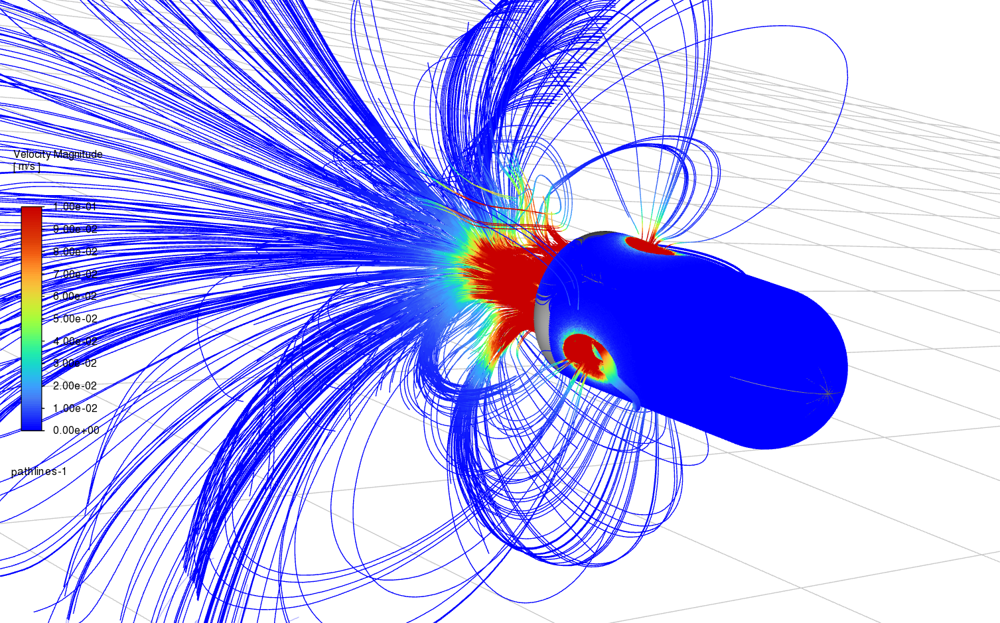
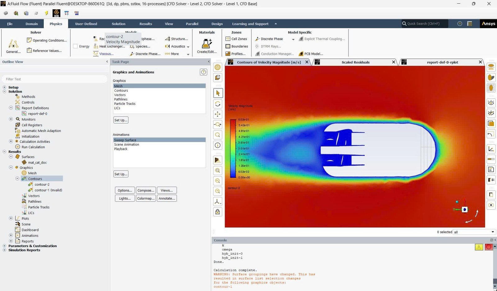
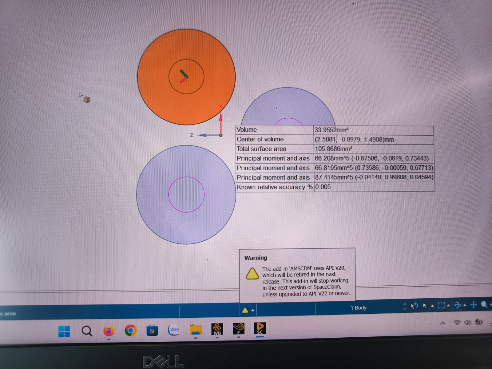
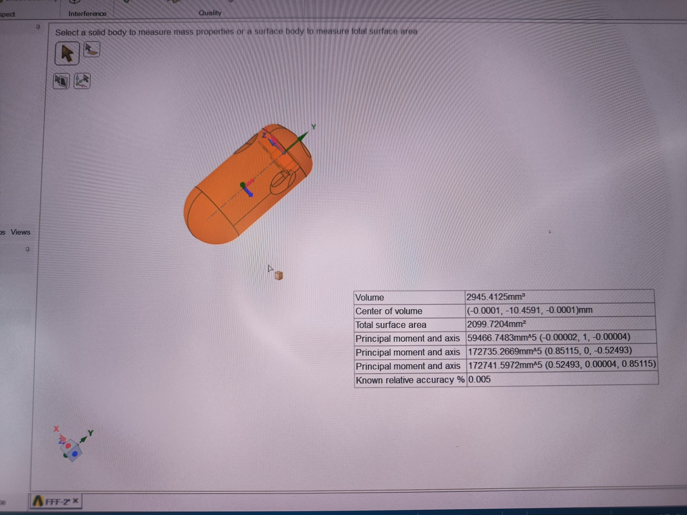
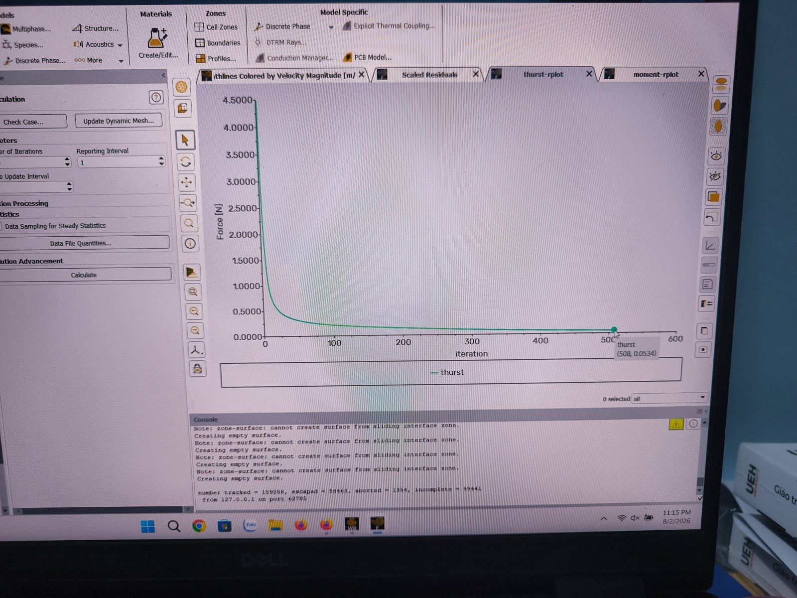

# CapsuleBot

CAD and propulsion analysis for an underwater capsule robot. The repository includes SolidWorks and STEP geometry, ANSYS Fluent force reports, and scripts for comparing simulated propeller loads across operating speeds.



| Path | Contents |
| --- | --- |
| [capsule](capsule) | Capsule CAD parts and SolidWorks assembly |
| [PropellerAnalyzer](PropellerAnalyzer) | Blade element momentum theory (BEMT) analysis and Fluent report plotting |
| [Data](Data) | Fluent force and moment reports for 3,000–12,000 rpm and reference plots |
| [matlab](matlab) | Theoretical thrust calculation |

## CFD gallery

| Velocity contour | Simulation domains |
| --- | --- |
|  |  |

| Capsule geometry | Solver convergence |
| --- | --- |
|  |  |

## Reproduce the analysis

Run from the repository root:

```bash
python -m pip install -r requirements.txt
python PropellerAnalyzer/main.py
python PropellerAnalyzer/plot_fluent_loads.py Data
```

The BEMT map uses provisional blade geometry and section polars. The Fluent report command averages the last 100 iterations by default. See the [analyzer notes](PropellerAnalyzer/README.md) for assumptions and guidance on comparing the models. The optional STEP geometry utilities use CadQuery.
